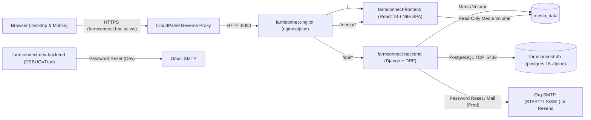

# System Architecture — FarmConnect

## 1. System Context & Target Users

FarmConnect is a full-stack agricultural marketplace serving three user groups:
- **Customers**: Browse fresh produce by category or search/location filters, estimate approximate town-to-town distances, manage carts, place orders, and track delivery status.
- **Farmers**: Register with farm details and public town/city location, publish/remove produce listings with images, accept/reject incoming order items, and update profile information.
- **Admins**: Moderate users, farmers, products, and orders via the `/admin` dashboard and Django Admin.

---

## 2. High-Level Architecture

---

## 3. Frontend Component Architecture

- **App Shell & Providers** ([frontend/src/App.tsx](../../frontend/src/App.tsx)):
  - `QueryClientProvider` (TanStack React Query) for server-state caching and invalidation.
  - `AuthProvider` ([auth-context.tsx](../../frontend/src/lib/auth-context.tsx)) for JWT session state and profile updates.
  - `CartProvider` ([cart-context.tsx](../../frontend/src/lib/cart-context.tsx)) for guest + authenticated cart synchronization.
  - `ProductProvider` ([product-context.tsx](../../frontend/src/lib/product-context.tsx)).
- **Layout Boundaries**:
  - Public/Customer pages render [`Navbar`](../../frontend/src/components/Navbar.tsx) and [`Footer`](../../frontend/src/components/Footer.tsx).
  - Farmer pages render inside [`FarmerLayout`](../../frontend/src/layouts/FarmerLayout.tsx) + [`DashboardSidebar`](../../frontend/src/components/DashboardSidebar.tsx) (`< 768px`: collapsible Radix `Sheet` drawer; `>= 768px`: persistent collapsible sidebar).
  - Admin pages render inside [`AdminLayout`](../../frontend/src/layouts/AdminLayout.tsx) + [`DashboardSidebar`](../../frontend/src/components/DashboardSidebar.tsx) (`< 768px`: collapsible drawer with mobile Logout and scroll-to-top; `AdminUsers`, `AdminFarmers`, and `AdminProducts` reuse shared components like [`AdminProductManagementPanel`](../../frontend/src/components/admin/AdminProductManagementPanel.tsx) & [`AdminProductFormDialog`](../../frontend/src/components/admin/AdminProductFormDialog.tsx) to adapt cleanly between `< 768px` stacked cards and `>= 768px` tables).
- **Interactive Category & Product Components**:
  - [`ShopByCategorySection`](../../frontend/src/components/ShopByCategorySection.tsx) + [`CategoryProductPreviewModal`](../../frontend/src/components/CategoryProductPreviewModal.tsx) + [`ProductCard`](../../frontend/src/components/ProductCard.tsx).

---

## 4. Django Application & Service Boundaries

| App | Responsibility | Key Modules |
| :--- | :--- | :--- |
| `backend` | Settings, root URL routing, global exception handling, email service | `settings.py`, `urls.py`, `exceptions.py`, `email_service.py` |
| `users` | Custom `User` (`Super Admin` via `is_superuser` / `General Admin` via `user_type='admin'`), `FarmerProfile`, `CustomerProfile`, `AdminAuditLog`, JWT auth, password reset, rate limiting | `models.py`, `serializers.py`, `api_views.py`, `permissions.py`, `throttles.py` |
| `products` | `Category` (7 approved categories) and `Product` catalog, image validation, location/category filtering | `models.py`, `serializers.py`, `api_views.py`, `migrations/0004_seed_approved_categories.py` |
| `orders` | `Cart`, `CartItem`, `Order`, `OrderItem`, checkout, and farmer item fulfillment | `models.py`, `serializers.py`, `api_views.py`, `order_views.py` |
| `payments` | `Payment` model linked 1:1 with `Order` | `models.py`, `admin.py` |
| `reviews` | `PlatformTestimonial` and `ProductReview` models, anti-abuse validation, moderation workflow | `models.py`, `serializers.py`, `api_views.py`, `admin.py`, `urls.py` |

---

## 5. Key Workflows & Data Flows

### Farmer Profile Update & Product Synchronization
1. Farmer submits updated `first_name`, `last_name`, `phone`, `farm_name`, `location`, and `description` on [`FarmerProfile`](../../frontend/src/pages/farmer/FarmerProfile.tsx).
2. Frontend sends `PATCH /api/v1/auth/profile/update/` via `updateProfile()`.
3. [`UserUpdateSerializer`](../../backend/users/serializers.py#L93-L128) validates and persists changes to `users_user` and `users_farmerprofile` in PostgreSQL.
4. Backend returns updated `UserSerializer` payload; `AuthContext` updates `user` state.
5. `FarmerProfile` invalidates `["products"]` and `["product"]` in React Query so **Featured Products**, **Marketplace**, **Shop by Category**, **Quick Preview**, and **Product Details** immediately fetch fresh `farmer_name` and `farmer_location` from PostgreSQL via [`ProductSerializer`](../../backend/products/serializers.py#L54-L95).

### REST API Authentication Flow
- `POST /api/v1/auth/login/` returns `access` (60 min) and `refresh` (1 day) JWTs stored in `localStorage` (`auth_tokens`).
- Axios request interceptor attaches `Authorization: Bearer <access>`.
- On `401`, Axios response interceptor calls `POST /api/v1/auth/token/refresh/` (`ActiveUserTokenRefreshView`) and retries the original request; on refresh failure, clears `auth_tokens` and redirects to `/login`.
- Suspending/deactivating a user (`is_active=False`) blacklists all existing `OutstandingToken` records via `revoke_user_refresh_tokens()`, and `ActiveUserTokenRefreshSerializer` rejects refresh exchanges (`401`) for inactive/missing users.

---

## 6. Environments, Docker & Reverse Proxy

- **Development (`docker-compose.dev.yaml`)**: Isolated network `farmconnect-dev-network`, gateway on `127.0.0.1:18080`, separate `farmconnect_dev_postgres_data` and `farmconnect_dev_media` volumes, `DEBUG=True`, Gmail SMTP enabled.
- **Production (`docker-compose.yaml`)**: Network `farmconnect`, Nginx proxy on `10.50.103.90:8080` behind CloudPanel reverse proxy for `farmconnect.hpc.ac.zw`, separate `postgres_data` and `media_data` volumes.
- **Media Sharing**: Both `backend`/`dev-backend` (read-write) and `frontend`/`dev-frontend` (read-only) mount the media volume so Nginx serves `/media/*` directly from the frontend container.

---

## 7. Security Controls & Trust Boundaries

- **Public vs. Authenticated**: Product browsing and category listing are `IsAuthenticatedOrReadOnly`; cart, checkout, and profile updates require valid JWTs.
- **Administrative RBAC & Audit Trail**: [`IsAdmin`](../../backend/users/permissions.py) allows active General Admins and Super Admins (`is_active=True`); [`IsSuperAdmin`](../../backend/users/permissions.py) restricts role assignments (`PATCH /api/v1/auth/admin/users/<pk>/role/`), administrator suspensions, user deletion, and audit log access (`GET /api/v1/auth/admin/audit-logs/`) to active Super Admins (`is_superuser=True`). Self-demotion, self-suspension, modifying Super Admins, and disabling the last active Super Admin are blocked; sensitive actions are recorded in immutable `AdminAuditLog` entries without secrets.
- **Ownership Enforcement**: `update_profile` scopes strictly to `request.user` and rejects privilege fields; `product_detail` (`PUT`/`PATCH`/`DELETE`) checks `product.farmer == request.user` (or admin); `update_order_item_status` filters by `product__farmer=request.user`.
- **Historical Data & Deletion Protection**: `Order.customer`, `OrderItem.product`, `Product.farmer`, `ProductReview.product`, and `ProductReview.customer` use `on_delete=PROTECT` to prevent ORM cascades. `NoHardDeleteAdminMixin` ([`backend/admin_mixins.py`](../../backend/backend/admin_mixins.py)) disables single and bulk hard deletion across `CustomUserAdmin`, `FarmerProfileAdmin`, `ProductAdmin`, `OrderAdmin`, `OrderItemAdmin`, `PaymentAdmin`, `PlatformTestimonialAdmin`, and `ProductReviewAdmin`; `DELETE /api/v1/auth/admin/users/<pk>/` rejects destructive user deletion (`400`, directing callers to `/status/` suspension); and `Product` `DELETE` performs soft removal (`moderation_status='removed'`). Only direct database superuser SQL or explicit shell deletion of child rows first remains a privileged backdoor.
- **Farmer & Product Moderation Enforcement**: [`users/permissions.py`](../../backend/users/permissions.py) (`is_approved_farmer_user`, `is_product_farmer_purchasable`, `is_product_publicly_visible`, `public_purchasable_product_q`) enforces both `FarmerProfile.status == 'approved'` (separate from `User.is_active`) and `Product.moderation_status == 'active'` across public catalog listings, direct product detail access, cart additions/updates, and checkout validation while preserving historical `OrderItem` and `ProductReview` rows via soft removal (`moderation_status='removed'`). All farmer and product moderation mutations log to `AdminAuditLog`.
- **Location Privacy**: Only public town/city/district strings (`FarmerProfile.location`) are exposed on products. Approximate distance calculation in [`zimbabwe-locations.ts`](../../frontend/src/lib/zimbabwe-locations.ts) runs client-side using static town centroids; no GPS or street addresses are collected or exposed.
- **Upload Validation**: Both `nginx-proxy.conf` and `nginx-dev.conf` allow `client_max_body_size 6M;` on `/api/` for multipart overhead, while `ProductImageField` strictly enforces `<= 5 MB`, `.jpg`/`.jpeg`/`.png`/`.webp`, and `Pillow` header verification.

---

## 8. Performance, Scalability & Monitoring Considerations

- **Current Optimizations**: `select_related('farmer', 'farmer__farmer_profile', 'category')` on product queries; `PageNumberPagination` (`page_size=10`, `max_page_size=100`); lazy-loaded React routes; React Query client caching.
- **Known Bottlenecks / Future Scaling** *(proposed, not load-tested)*:
  - Backend runs single-container Gunicorn/Django behind Nginx; horizontal scaling would require externalizing media storage (e.g., S3/object storage) instead of local Docker volumes.
  - Logging currently uses Python `logging` to container stdout/stderr (`backend/exceptions.py`, `email_service.py`); centralized log aggregation and uptime alerting are **Not yet verified / not configured**.
- **Load Claims**: No load testing has been performed; no specific concurrent-user capacity is claimed.

