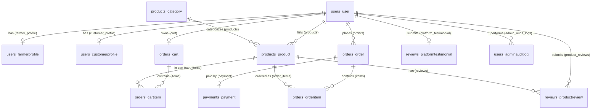

# Database Design — FarmConnect

All schema details below are verified directly against the Django models in `backend/users/models.py`, `backend/products/models.py`, `backend/orders/models.py`, and `backend/payments/models.py`.

## 1. Entity Relationship Diagram

---

## 2. Tables & Columns (Verified Existing Schema)

### `users_user` ([backend/users/models.py](../../backend/users/models.py))
Inherits `AbstractUser` (`id` BigAutoField PK, `password`, `last_login`, `is_superuser`, `username`, `first_name`, `last_name`, `is_staff`, `is_active`, `date_joined`), with `USERNAME_FIELD = 'email'`:
- `email`: `EmailField`, `unique=True` (indexed by Django unique constraint)
- `phone`: `CharField(max_length=13, blank=True, null=True)`
- `user_type`: `CharField(max_length=10, choices=['admin','farmer','customer'], default='customer')`
- `is_verified`: `BooleanField(default=False)`
- `created_at`: `DateTimeField(auto_now_add=True)`
- `updated_at`: `DateTimeField(auto_now=True)`

### `users_farmerprofile` ([backend/users/models.py](../../backend/users/models.py))
- `id`: `BigAutoField` PK
- `user_id`: `OneToOneField(User, on_delete=CASCADE, related_name='farmer_profile')`
- `farm_name`: `CharField(max_length=255)`
- `location`: `CharField(max_length=255)` (public city/town/district)
- `description`: `TextField(blank=True)`
- `status`: `CharField(max_length=20, choices=['pending','approved','suspended'], default='pending', db_index=True)`
- `status_reason`: `TextField(blank=True, default='')`
- `status_updated_at`: `DateTimeField(null=True, blank=True)`
- `status_updated_by_id`: `ForeignKey(User, SET_NULL, null=True, blank=True, related_name='farmer_status_updates')`
- `created_at`, `updated_at`: `DateTimeField`

### `users_customerprofile` ([backend/users/models.py](../../backend/users/models.py))
- `id`: `BigAutoField` PK
- `user_id`: `OneToOneField(User, on_delete=CASCADE, related_name='customer_profile')`
- `address`: `TextField(blank=True)`
- `city`: `CharField(max_length=100, blank=True)`
- `created_at`, `updated_at`: `DateTimeField`

### `users_adminauditlog` ([backend/users/models.py](../../backend/users/models.py))
- `id`: `BigAutoField` PK
- `actor_id`: `ForeignKey(User, on_delete=SET_NULL, null=True, blank=True, related_name='admin_audit_logs')`
- `actor_email`: `EmailField(blank=True, default='')`
- `action`: `CharField(max_length=64, db_index=True)`
- `target_type`: `CharField(max_length=64, db_index=True)`
- `target_id`: `CharField(max_length=64, blank=True, default='', db_index=True)`
- `target_repr`: `CharField(max_length=255, blank=True, default='')`
- `details`: `JSONField(default=dict, blank=True)` (sanitized via `_sanitize_audit_details` to exclude passwords, tokens, and secrets)
- `created_at`: `DateTimeField(auto_now_add=True, db_index=True)`
- Ordering: `('-created_at',)`; read-only via API and Django Admin.

### `products_category` ([backend/products/models.py](../../backend/products/models.py))
- `id`: `BigAutoField` PK
- `name`: `CharField(max_length=100)`
- `slug`: `SlugField`, `unique=True`
- `description`: `TextField(blank=True)`
- `image`: `ImageField(upload_to='categories/', blank=True, null=True)`

### `products_product` ([backend/products/models.py](../../backend/products/models.py))
- `id`: `BigAutoField` PK
- `farmer_id`: `ForeignKey(User, on_delete=PROTECT, related_name='products')` (protects farmers with products from accidental ORM cascade deletion)
- `category_id`: `ForeignKey(Category, on_delete=SET_NULL, null=True, related_name='products')`
- `name`: `CharField(max_length=255)`
- `slug`: `SlugField`, `unique=True`
- `description`: `TextField`
- `price`: `DecimalField(max_digits=10, decimal_places=2)`
- `stock`: `PositiveIntegerField(default=0)`
- `image`: `ImageField(upload_to='products/', blank=True, null=True)`
- `is_available`: `BooleanField(default=True)` (computed in `Product.save()` as `self.stock > 0`)
- `moderation_status`: `CharField(max_length=20, choices=['active','hidden','removed'], default='active', db_index=True)`
- `moderated_by_id`: `ForeignKey(User, on_delete=SET_NULL, null=True, blank=True, related_name='moderated_products')`
- `moderated_at`: `DateTimeField(null=True, blank=True)`
- `moderation_reason`: `TextField(blank=True, default='')`
- `created_at`, `updated_at`: `DateTimeField`

### `orders_cart` & `orders_cartitem` ([backend/orders/models.py](../../backend/orders/models.py))
- `orders_cart`: `id` PK, `customer_id` `OneToOneField(User, CASCADE, related_name='cart')`, `created_at`, `updated_at`.
- `orders_cartitem`: `id` PK, `cart_id` `ForeignKey(Cart, CASCADE, related_name='items')`, `product_id` `ForeignKey(Product, CASCADE, related_name='cart_items')`, `quantity` `PositiveIntegerField(default=1)`, `price` `DecimalField(max_digits=10, decimal_places=2)`.
  - Unique constraint: `unique_together = ('cart', 'product')`.

### `orders_order` & `orders_orderitem` ([backend/orders/models.py](../../backend/orders/models.py))
- `orders_order`: `id` PK, `customer_id` `ForeignKey(User, PROTECT, related_name='orders')`, `first_name` (50), `last_name` (50), `email`, `phone` (20, `blank=True, default=''`), `address` (250), `postal_code` (20), `city` (100), `total_amount` `DecimalField(10,2, default=0.00)`, `status` (`pending|paid|shipped|delivered|cancelled`), `created_at`, `updated_at`. Default ordering: `('-created_at',)`.
- `orders_orderitem`: `id` PK, `order_id` `ForeignKey(Order, CASCADE, related_name='items')`, `product_id` `ForeignKey(Product, PROTECT, related_name='order_items')`, `price` `DecimalField(10,2)`, `quantity` `PositiveIntegerField(default=1)`, `status` (`pending|accepted|rejected|shipped|delivered`). (`PROTECT` on `Order.customer` and `OrderItem.product` preserves historical transaction records.)

### `payments_payment` ([backend/payments/models.py](../../backend/payments/models.py))
- `id` PK, `order_id` `OneToOneField(Order, CASCADE, related_name='payment')`, `method` (`card|transfer|mobile_money|cod`), `status` (`pending|completed|failed|refunded`), `amount` `DecimalField(10,2)`, `transaction_id` `CharField(100, blank=True, null=True)`, `created_at`, `updated_at`.

### `reviews_platformtestimonial` ([backend/reviews/models.py](../../backend/reviews/models.py))
- `id`: `BigAutoField` PK
- `customer_id`: `OneToOneField(User, CASCADE, related_name='platform_testimonial')` (enforces 1 testimonial per customer at DB level)
- `rating`: `PositiveSmallIntegerField(validators=[1..5])`
- `comment`: `TextField(max_length=1000)`
- `display_name`: `CharField(max_length=100, blank=True, default='')` (optional customer-approved name)
- `role_or_title`: `CharField(max_length=100, blank=True, default='')`
- `consent_public`: `BooleanField(default=False)` (explicit customer consent required)
- `status`: `CharField(max_length=20, choices=['pending','approved','rejected'], default='pending', db_index=True)`
- `is_verified_buyer`: `BooleanField(default=False)` (requires independent verifiable real-payment proof; kept disabled for simulated checkouts)
- `moderated_by_id`: `ForeignKey(User, SET_NULL, null=True, blank=True, related_name='moderated_testimonials')`
- `moderated_at`: `DateTimeField(null=True, blank=True)`
- `created_at`, `updated_at`: `DateTimeField`

### `reviews_productreview` ([backend/reviews/models.py](../../backend/reviews/models.py))
- `id`: `BigAutoField` PK
- `product_id`: `ForeignKey(Product, PROTECT, related_name='reviews')`
- `customer_id`: `ForeignKey(User, PROTECT, related_name='product_reviews')`
- `rating`: `PositiveSmallIntegerField(validators=[1..5])`
- `title`: `CharField(max_length=120, blank=True, default='')`
- `comment`: `TextField(max_length=1000)`
- `status`: `CharField(max_length=20, choices=['pending','approved','rejected'], default='pending', db_index=True)`
- `verified_purchase`: `BooleanField(default=False)` (kept disabled until reliable real payment gateway verification exists)
- `moderated_by_id`: `ForeignKey(User, SET_NULL, null=True, blank=True, related_name='moderated_product_reviews')`
- `moderated_at`: `DateTimeField(null=True, blank=True)`
- `created_at`, `updated_at`: `DateTimeField`
- Unique constraint: `UniqueConstraint(fields=['product', 'customer'], name='unique_product_customer_review')`

---

## 3. Normalization, Consistency & Transaction Integrity

- **Authoritative Farmer Info**: `Product` stores only `farmer_id` (`FK -> User`), not duplicated `farmer_name` or `farmer_location`. Product API queries use `select_related('farmer', 'farmer__farmer_profile', 'category')`.
- **Atomic Registration**: `UserRegistrationSerializer.create` is wrapped in `@transaction.atomic` so `User` and `FarmerProfile`/`CustomerProfile` are created together or rolled back together.
- **Data Privacy**: `CustomerProfile.address` and `Order.address` are never exposed on public product endpoints.

---

## 4. Proposed Indexing & Operational Notes *(Not Yet Implemented)*

- **Current Indexes**: Django default PK indexes, `unique` indexes (`users_user.email`, `products_category.slug`, `products_product.slug`, `orders_cartitem(cart_id, product_id)`), and FK indexes.
- **Proposed Future Indexes**: Index on `products_product(is_available, created_at)` and `users_farmerprofile(location)` if catalog size grows significantly.
- **Backups**: Production PostgreSQL data lives in Docker volume `postgres_data`; automated `pg_dump` backup schedule is **Not yet verified**.

